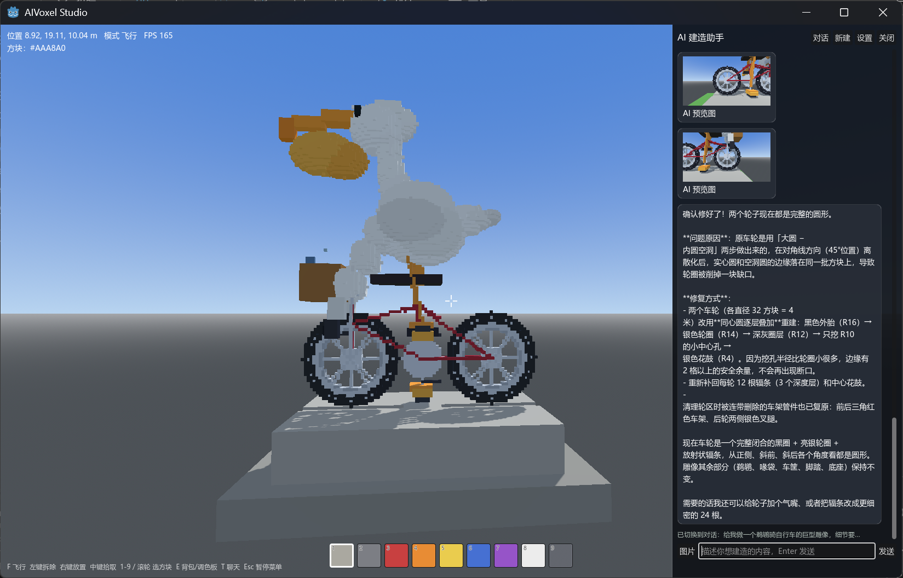
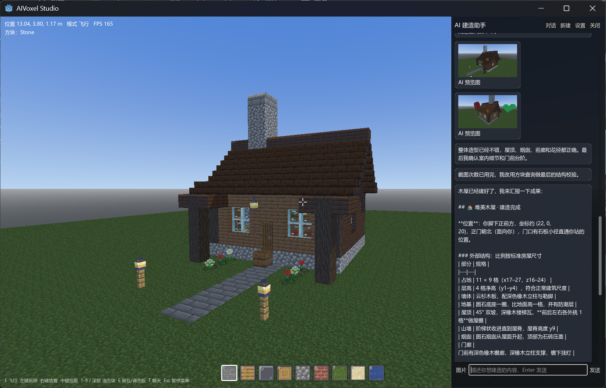

# AIVoxel Studio

AIVoxel Studio 是一个基于 **Godot 4.7** 与 **C#** 的AI体素建模工具。使用大模型全自动一键生成完整体素建模。

An open-source voxel modeling tool built with Godot 4.7 and C#, featuring AI-assisted building via LLM tool calling.

## Features

- **一句话生成**：只需提供一个描述或参考图，AI全自动完成体素模型建造产出。支持自主思考，计划，并完成模型构建，检查，修改。
- **建模体系**
  - 通用体素方案：适合较高分辨率模型，导出为通用模型格式。
  - 我的世界方案：支持游戏内方块与其状态属性，导出为 Java 版MC存档或结构方块 NBT。（此方案下暂时不支持导出为通用格式）
- **切片导出**：支持切片导出方案内的局部区域。

## Screenshot





## Development plan

**当前的开发计划：**

- [ ] 手动编辑模式下的批量工具
- [x] OBJ 导出
- [ ] OBJ MTL材质导出
- [ ] GLTF 导出
- [ ] FBX 导出
- [x] Minecraft JE存档导出（仅我的世界方案）
- [x] Minecraft NBT导出（仅我的世界方案）
- [ ] Agent 提问工具

## Quick Start

1. 使用 Godot 4.7 editor(mono) 打开 `src/project.godot`。进行编译或下载Release中的最新二进制
2. 在AI设置页面中填写 API Base URL、模型名与密钥。
3. 新建方案，选择建模类型；并进入编辑页面
4. 按下`T`，打开聊天对话框，输入想要建造的模型描述
5. 等待Agent建模完成，预览，微调建造结果
6. 按下ESC，点击导出按钮，选择需要的格式并导出

## 导出格式

| 模式 | 格式 | 用途 |
| --- | --- | --- |
| 纯色体素 | `.obj` | 通用三维模型，整世界或选区 |
| 纯色体素 | `.glb` | *待支持* |
| 纯色体素 | `.fbx` | *待支持* |
| 我的世界 | 世界存档（`level.dat` + `region/*.mca`） | 放入 `saves` 目录即可导入MC JE游戏中 |
| 我的世界 | `.nbt` | 使用游戏内结构方块与 `/place template` 放置到世界 |

## 目录结构

```
src/
├─ AI/                LLM 客户端、对话引擎与工具注册表
├─ App/               设置与应用级服务
├─ Core/              世界数据、模式抽象、存档与导出
├─ Player/            玩家控制器
├─ Render/            网格构建、渲染与编辑辅助线
├─ UI/                .tscn 场景与对应脚本
└─ Prompts/           各模式的系统提示词
```

## 参与贡献

欢迎提交 Issue 与 Pull Request。期待您的支持！